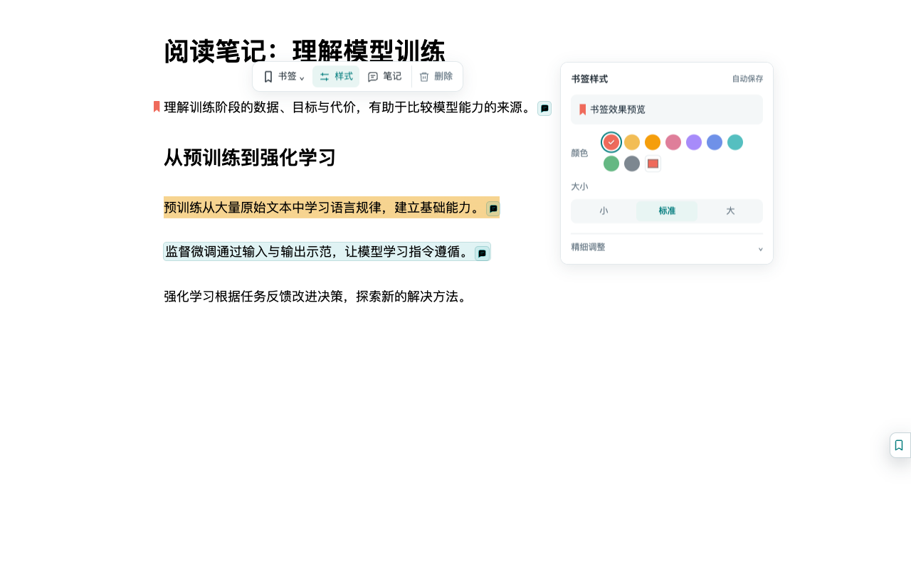
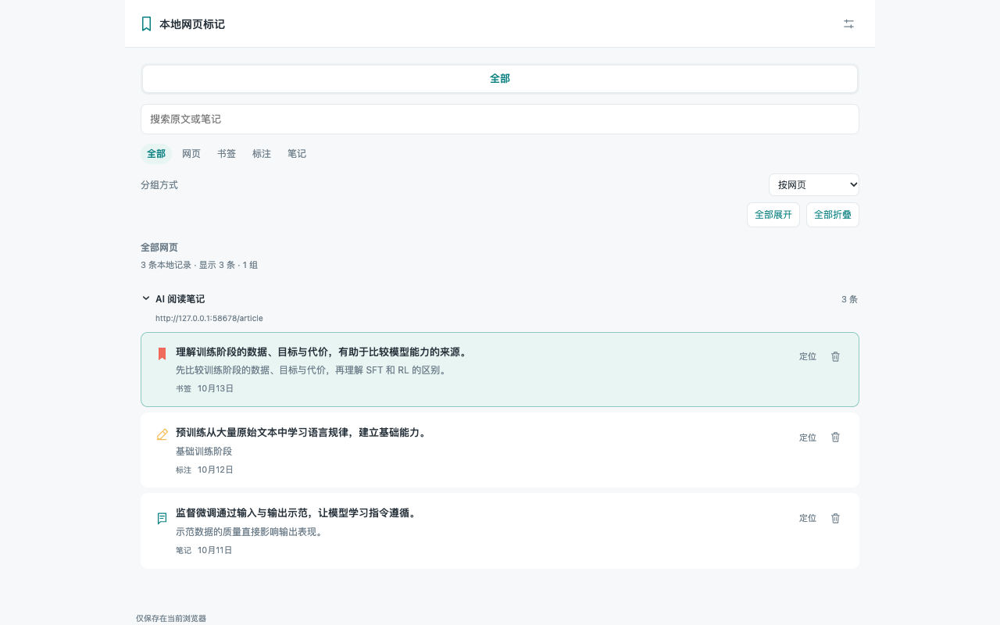

# 本地网页标记 · 360 兼容预览分支

在 360 极速浏览器中为网页添加书签、高亮、下划线和笔记，把阅读记录保存在当前浏览器里。无需账号，支持本地备份，不自动上传内容。

此分支为 `compat/360-chromium-132`，面向 Chromium 132 的 360 极速浏览器 Pro。Chrome 稳定版仍保留在 [main](https://github.com/Niejinge/chrome-local-marks/tree/main) 和 [v0.7.4](https://github.com/Niejinge/chrome-local-marks/releases/tag/v0.7.4)，两者使用不同安装目录。兼容版使用独立标记管理窗口，保留本页／全部、详情、定位与自动保存，不申请原生侧栏权限。

[360 兼容预览下载](https://github.com/Niejinge/chrome-local-marks/releases/tag/v0.7.5-360-preview) · [Chrome 稳定版下载](https://github.com/Niejinge/chrome-local-marks/releases/latest) · [反馈问题](https://github.com/Niejinge/chrome-local-marks/issues) · [更新记录](CHANGELOG.md)



## 功能

- **标记原文**：紧凑书签旗、高亮、直线下划线、波浪线，各类型独立记住颜色、大小和透明度。修改标注类型后，下一次新增沿用该类型。
- **随手记笔记**：可单独添加笔记，也可附在标注上；输入与样式自动保存，支持中文输入法。网页浮层可快捷删除笔记，并在 8 秒内撤销。
- **回到阅读位置**：点击列表记录查看详情并定位原文；打开管理窗口保持当前阅读位置。
- **整理多页记录**：本页与全部范围、搜索、类型筛选、按网页／网站分组及时间排序。全部范围的分组默认折叠，支持一键展开与折叠。
- **本地管理**：网页收藏、JSON 导出／导入、存储用量提示和删除撤销。跟随系统浅色／深色主题。

## 安装

兼容目标为 **Chromium 132 或以上**，已实测 macOS arm64 的 360 极速浏览器 Pro 16.0.1098.0；Windows 版及其它内核版本尚未实测。此分支仍属兼容预览，不替代 Chrome 稳定版。

直接下载 [360 兼容插件 ZIP](https://github.com/Niejinge/chrome-local-marks/releases/download/v0.7.5-360-preview/chrome-local-marks-360-preview.zip)，版本说明和 SHA-256 校验文件见 [预发布版本](https://github.com/Niejinge/chrome-local-marks/releases/tag/v0.7.5-360-preview)。开发者也可克隆此分支后运行 `python3 -B package_release.py`，生成 `dist/chrome-local-marks-360-unpacked` 及 `dist/chrome-local-marks-360-preview-0.7.5.zip`。

以下使用兼容包安装：

1. 将兼容 ZIP 解压到固定文件夹，或直接使用构建后的 `dist/chrome-local-marks-360-unpacked`。不要覆盖 Chrome 稳定版安装目录。
2. 在 360 中打开 `chrome://extensions/`，开启右上角的“开发者模式”。
3. 点击“加载已解压的扩展程序”，选择解压后**直接包含 `manifest.json`** 的文件夹。
4. 刷新已经打开的网页。选中文字开始标记，或点击网页侧边的书签图标／浏览器扩展图标打开标记管理窗口。

请下载 Release 中的插件 ZIP；GitHub 自动生成的 `Source code (zip)` 是源码，需先按[开发说明](CONTRIBUTING.md)打包。

### 更新

先从“设置与数据”导出备份。将新版解压文件覆盖到原安装文件夹，在 `chrome://extensions/` 点击“重新加载”，再刷新网页。保持安装路径不变，无需卸载。更换安装路径、扩展 ID 或 Chrome 配置文件时，记录不会自动迁移，需要手动导入备份。

### 基本使用

选中文字后选择“书签”“标注”或“笔记”。悬停或点击“标注”可选高亮、直线、波浪线；点击已有标注可切换类型或调整样式。笔记和样式自动保存，无需手动点击保存。

列表记录主体同时打开详情并定位原文，右侧另有独立定位与删除按钮。笔记预览和编辑框中的“删除笔记”只移除笔记，保留附带标注；纯笔记会移除整条记录。



## 支持范围与数据

- 普通 HTTP／HTTPS 网页，以及开启扩展详情页“允许访问文件网址”后的本地 HTML 文档。
- Chrome 设置页、网上应用店、新标签页及内置 PDF 阅读器等受保护页面不支持标记；iframe 内容和部分虚拟列表暂不支持。
- 网页内容大幅变化、删除原文或反复动态重绘时，旧标记可能无法恢复或定位。记录仍保存在列表里，可查看原文与笔记。
- 数据保存在当前 Chrome 配置文件的 `chrome.storage.local` 中，不自动跨设备同步。卸载或清理扩展数据前请导出备份。
- JSON 备份包含网页地址、原文、笔记和样式，可能含私人内容，请勿直接附在公开 Issue 中。默认标注类型、入口位置和分组方式等偏好不随备份迁移。

兼容说明与测试范围见 [docs/360-COMPATIBILITY.md](docs/360-COMPATIBILITY.md)。

完整的数据与权限说明见 [PRIVACY.md](PRIVACY.md)。

## 开发与参与

原生 JavaScript、HTML、CSS，使用 Manifest V3，无框架或运行时 npm 依赖。

```sh
git clone --branch compat/360-chromium-132 https://github.com/Niejinge/chrome-local-marks.git
cd chrome-local-marks
python3 -B package_release.py
```

然后加载 `dist/chrome-local-marks-360-unpacked`。贡献流程、项目结构与测试见 [CONTRIBUTING.md](CONTRIBUTING.md)，版本打包见 [RELEASING.md](RELEASING.md)。欢迎通过 [Issues](https://github.com/Niejinge/chrome-local-marks/issues) 反馈问题或提出建议，通过 Pull Request 提交改进。

## 许可证

采用 [MIT License](LICENSE)。
